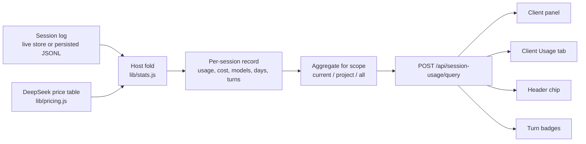

# Architecture

This document describes how the plugin turns committed Session events into the
four surfaces a user sees. The short version: the Host folds the log, the Client
renders the result, and the in-memory index is disposable.

## Data flow



## Host half (`index.js`)

### Session discovery

- `ctx.get('sessions').list()` provides live Session objects.
- `ctx.get('sessionQuery').listSessions()` provides the complete logical corpus
  as headers, newest first. The project cwd filter is applied before the
  `maxSessions` cap, so the cap is per selected scope rather than global.
- Live sessions that are not in the persisted listing are appended (and filtered
  by the same cwd rule for project scope), so a brand new conversation still
  appears in **All conversations** before its first flush.

### Folding

For each session, `lib/stats.js` walks committed events:

| Event | Effect |
| --- | --- |
| `session/title` | Latest title wins; used for labels and the list |
| `user/message` | Counts inputs; captures a 120-character fallback title |
| `turn/start` | Creates the turn bucket |
| `turn/end` | Records the turn's closing sequence |
| `step/start` | Counts steps, per session and per turn |
| `request/header`, `request/context` | Records the current model/provider for later attempts |
| `llm/retry-started` | Closes the current `(turn, step)` call slot so the next attempt accumulates rather than replaces |
| `assistant/message` | Adds or replaces the current call sample: usage (or last stream usage) plus price in session, model, day, and turn buckets |
| `assistant/attempt` | Adds or replaces the current call sample for the stream usage, without incrementing the visible-message count |

Rules that matter:

- **Inherited events are skipped.** `readSession()` returns
  `inheritedEventCount`; events below that cut were copied from a parent at fork
  time and must not be billed twice.
- **Live increments are deduplicated.** Every record stores `lastSeq`; folding a
  live session again skips events already seen. Folding is pure, so a cold read
  followed by live `ownEvents()` is safe.
- **Same-call revisions replace.** A sample is keyed by `(turn, step)`. The next
  sample for that slot subtracts the previous contribution from every bucket
  before adding the revision; `llm/retry-started` clears the slot. This mirrors
  the Harness token-meter's replace-versus-retry semantics.
- **Missing samples retain; explicit zero samples replace.** A message revision
  with no `data.usage` and no stream usage updates only the visible-message
  count, leaving the prior token/cost contribution intact. An explicit zero
  sample (including a zero attempt) replaces the prior contribution with zero.
- **A cold record is folded at most once.** `ensureRecord()`/`ensureById()` share
  a per-session load promise, and `foldCold()` refuses to fold an already loaded
  record. Two concurrent **All conversations** requests therefore read one cold
  log once and produce one total, not two.
- **Live-to-cold gets a final tail sync.** If a cached record is still `live` but
  its live session disappears, one shared refresh reads persistence, folds only
  events after `lastSeq`, updates `live=false`, and retries on failure. A
  `liveGeneration` check prevents a slow stale sync from overwriting a newer
  live reactivation.
- **Failed attempts are billable.** An `assistant/attempt` has no
  `assistant/message`; its only token accounting is the last `usage` chunk in
  `data.stream`. Those tokens and their price are counted, while the visible
  message count stays unchanged.
- **Price is computed per model call.** `lib/pricing.js` chooses the rate row by
  model id and the peak/off-peak multiplier from the event time (Beijing
  calendar), then applies the token buckets.
- **Token totals** follow `TokenUsage`: `totalTokens` when supplied, otherwise
  `input + cacheRead + cacheWrite + output`. `outputTokens` already contains
  reasoning tokens.
- **Days use the Beijing calendar date** (`YYYY-MM-DD`), so the daily curve is
  stable regardless of the Host machine's timezone.

### Cache

- One in-memory `Map<sessionId, record>`.
- Cold sessions are read once through `sessionQuery.readSession()`; an in-flight
  read map deduplicates concurrent reads, a per-session load map shares the fold,
  and at most three sessions are read at a time.
- `foldCold()` is guarded by `record.loaded`, so even a duplicate caller that
  already passed the load check cannot re-fold a completed snapshot.
- A separate refresh map shares the live-to-cold tail sync; it preserves
  `lastSeq`, folds only new persisted events, and sets `live=false`.
- Cold records are revalidated after five minutes, and the panel's manual
  refresh sends `refresh: true` to force a re-read of cold logs. This covers
  persistence updated by another Host/CLI that never appeared in this Host's
  live list.
- Live sessions are folded from `session.ownEvents()` on each query; `lastSeq`
  makes this incremental.
- The cache is not persisted. Restarting the Host or reloading the plugin
  rebuilds it on demand.

### Query route

`POST /api/session-usage/query`, registered through
`connection.fetch.register`, with a buffered JSON body:

```json
{ "scope": "current", "sessionId": "session-…" }
```

`scope` is `current`, `project`, or `all`. The response contains:

```text
ok, generatedAt, scope, currency, chartDays, peak
current: { id, title, cwd } | null
project: { cwd, label } | null
maxSeq                        (current scope only)
totals: { cost, tokens, input, output, cacheRead, cacheWrite, reasoning,
          sessions, turns, steps, messages, userMessages, cacheHitRate }
chart.daily[]                 zero-filled { label, day, cost, tokens, … }
chart.turns                   { maxTurn, series[], other }
session                       full current summary (current scope)
sessions[]                    summaries for project/all
warnings[]                    isolated per-session failures
```

`chart.turns.series` contains at most eight conversations, sorted by total cost;
`other` aggregates the rest by turn number. This bounds the payload while keeping
every conversation represented in the curve.

The route is authenticated by the Harness Connection service and is same-origin.
It has no side effects.

### Update route

`POST /api/session-usage/update`, also registered through
`connection.fetch.register`, with an optional buffered body `{ "force": true }`.
The Host reads the installed `package.json` version, fetches
`https://api.github.com/repos/Cottins-Vanilla/dsh-session-usage/releases/latest`,
compares the release tag with the installed version, and returns:

```text
ok, current, latest, updateAvailable
releaseUrl, releaseName, publishedAt, checkedAt
error: { code, message }       when ok is false
```

A successful result is cached for six hours; `force` bypasses the cache for an
explicit button press. Only the release tag, name, URL, and published time are
returned. The request is user-initiated, carries no session data, and its failure
does not affect the usage query.

## Client half (`client.js`)

### Slots

| Slot | Id | Purpose |
| --- | --- | --- |
| `sidebar.panellist` | `session-usage` | Sidebar icon and label |
| `main` | `session-usage` | Full dashboard |
| `conversation.view` | `usage` | **用量 / Usage** tab |
| `conversation.session.header.utilities` | `session-usage:header` | Header chip |
| `conversation.chat.turnTail` | `session-usage:turn-cost` | Per-answer price badge |

### State

- `currentStore` is a tiny module-level store holding the active session id,
  title, and working directory. The chip, View tab, and panel write it; the panel
  subscribes.
- `appearance.turnColor` holds the badge accent, initialized from
  `localStorage`. The panel's color row writes it; mounted badges subscribe.
- `sharedUsage` caches one current-session response for turn badges. Each badge
  matches its turn by the closing `seq` (or a turn hint when available); a new
  turn triggers one refetch, and older badges reuse the cached data.
- The panel's metric preference is stored in `localStorage`; the chart mode
  follows the scope (per-turn value for current, days for project/all) and can be
  changed for the session.

### Rendering

- The panel is a single scrollable root; the chart is an SVG built with
  `React.createElement` (no JSX, no chart dependency).
- Series colors are a fixed categorical palette; the aggregate series is gray.
  All other UI colors are `--dsw-alias-*` theme tokens.
- Copy goes through the Client locale service. Both `zh` and `en` dictionaries
  are registered in `apply`.
- The turn badge uses inline styles because it can render before the panel's
  stylesheet exists; it follows the same tokens and stays readable in both
  themes.

## Security boundaries

- The Host sends only aggregates, titles, and working directories. It never
  returns full prompts, tool results, attachments, or credentials. The one piece
  of message text it retains is a short fallback title (up to 120 characters)
  derived from the first user message when no `session/title` event exists.
- The Client cannot read the session log directly; it only calls the Host routes.
- No third-party request is made by default. The optional update check makes one
  Host-side request to the GitHub releases API when the user presses the button.
- The plugin never writes session events or profile files.

## Failure modes

| Failure | Result |
| --- | --- |
| `sessionQuery` unavailable | Query returns `ok: false` with a diagnostic; panel shows retry |
| One cold session unreadable | That session is skipped; `warnings[]` counts it |
| Invalid scope/session id | Empty current/project response or a diagnostic |
| Invalid pricing override | Plugin startup throws with the offending key; no silent fallback |
| Client route unauthorized | Panel/chip show an error; no data written |
| Update check offline or rate-limited | Header shows a non-blocking failure note; usage data stays usable |
| Log format migration | `readSession()` failure is isolated per session |

## Performance notes

- First **All conversations** query: one cold read per new session.
- Later queries: live events only; cold records are reused.
- Payload is bounded by eight detailed series plus an aggregate and a
  `maxSessions` cap.
- Turn badges share one request per conversation rather than one per turn.
